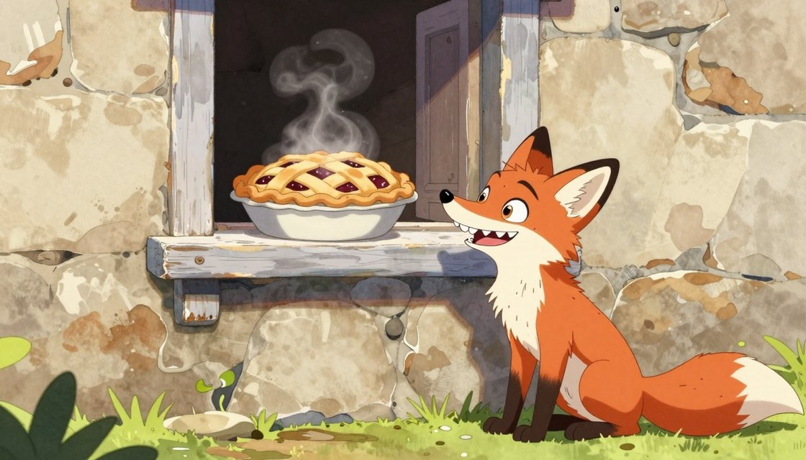
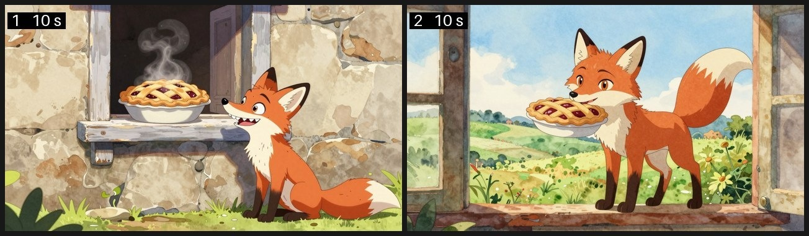
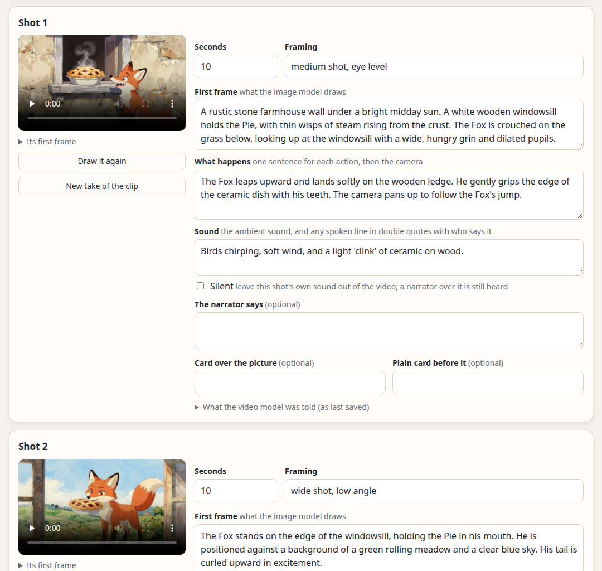

# videoharness

*A [Ma Da Hood Studios](https://madahood.com/) development project under Ipsa Solutions LLC.*

**Type a brief. Get a video.** videoharness turns one line into a finished
video on machines you own. A writer model on Ollama plans the shots, ComfyUI
draws and animates them, and ffmpeg cuts them together. Your briefs, prompts
and pictures never leave your network.

[](fox-pie.mp4)

*"The Pie Heist": 20 seconds with sound, from one line. This is its first
frame, and it links to the video. Machine-generated: the first frames by
Z-Image Turbo, the motion and sound by MiniMax H3.*

**The web page, with the install steps and example runs at length:
[madahood.com/videoharness](https://madahood.com/videoharness/).**

## How it works

| | Stage | What happens | Takes |
|---|---|---|---|
| 1 | Brief | One line from you: what happens, and the look. | you |
| 2 | Plan | A writer model on Ollama turns it into shots: the look, the cast, each shot's first frame, motion and sound. | about 30 s |
| 3 | Stills | ComfyUI draws each shot's first frame with Z-Image Turbo. | about 15 s each |
| 4 | Clips | ComfyUI animates each still with MiniMax H3, with its sound. | minutes each |
| 5 | Cut | ffmpeg joins the clips, levels the sound and lays any narration over. | seconds |

A plan takes seconds and a clip takes minutes. So you look at the cheap
stages first, a bad idea is caught before any clip is made, and a change
remakes only what it touches.

## What you need

- **Linux**, with Python 3.10 or later. macOS and Windows have not been tried.
- **[ComfyUI](https://www.comfy.org/) and [Ollama](https://ollama.com/)**, on
  this computer or on another at home, and **ffmpeg**.
- **The models**, which you fetch yourself: about 63 GB for ComfyUI and 20 GB
  for the writer.
- **Hardware.** The least it has been run on is one NVIDIA graphics card with
  16 GB, 32 GB of memory and 90 GB of free disk. There the 20-second example
  took between 17 and 23 minutes, depending on the memory it was given and on
  whether the writer had a machine of its own.

**Read the models' licences first.** Each model comes under its own licence,
which is not videoharness's. MiniMax H3 makes every clip. When this was
written its licence said it applies worldwide except the European Union, the
United Kingdom, the Republic of Korea and the United States of America, where
it asks you to contact MiniMax for a licence, and that what the model makes
may not be published without saying clearly that it is machine-generated.
Z-Image Turbo's page gave Apache 2.0.

## Install

Download the installer and its checksum into one folder:

```bash
wget https://github.com/kbiz76/mdh-videoharness/raw/main/videoharness-0.1.0-install.sh
wget https://github.com/kbiz76/mdh-videoharness/raw/main/videoharness-0.1.0-install.sh.sha256
```

Or open [`videoharness-0.1.0-install.sh`](videoharness-0.1.0-install.sh) and
[its checksum](videoharness-0.1.0-install.sh.sha256) here, and use the
download button on each one's page. In that folder, check that the file you
fetched is the one that was made:

```bash
sha256sum -c videoharness-0.1.0-install.sh.sha256
```

Then run it, as yourself and without `sudo`. It says what it is about to do
and asks before doing it:

```bash
bash videoharness-0.1.0-install.sh
```

It installs videoharness itself: the program, the `vh` command, and its own
page, which your computer serves to your browser. ComfyUI, Ollama, their
models and ffmpeg are yours to install. This lists what each of your servers
has, and what is still missing:

```bash
vh farm
```

For a missing model it names the file, the folder it goes in and where to
download it. When it ends with `Nothing is missing: a video can be made.`,
you are ready.

Every step, the models, servers on another computer, and what to check when
something does not work are in **[INSTALL.md](INSTALL.md)**.

## A first video

Stills cost seconds and clips cost minutes, so stop after the stills and
look:

```bash
vh make "A fox steals a cooling pie from a farmhouse windowsill and gets away with it. 2D watercolor animation." --seconds 20 --name fox-pie --until stills
```



On one 16 GB card that took 1 min 51 s. It wrote the plan, drew each shot's
first frame, and left them all on one sheet,
`~/videoharness/videos/fox-pie/stills/sheet.jpg`. Carry on by name to the
finished video:

```bash
vh make fox-pie
```

That took 15 min 4 s, and the video is
`~/videoharness/videos/fox-pie/fox-pie.mp4`. To change something, change its
words in the video's `plan.json` and run the same command again: only what
the change touches is remade.

The same command, steered:

| For | Run |
|---|---|
| An upright video | `vh make "..." --aspect 9:16` |
| One shot from each picture of yours | `vh make "..." --picture a.jpg b.jpg` |
| One continuous scene, each shot starting where the last ended | `vh make "..." --carry-on` |
| A narrator (the voice is Kokoro, which you install yourself) | `vh make "..." --narrate` |
| A narrator who says your own text, word for word | `vh make "..." --text story.txt` |
| The narrator's words on the picture as they are said | `vh make "..." --narrate --subtitles` |
| A title on a video already made, in seconds | `vh make fox-pie --title-card` |
| Another take of shot 2's clip | `vh clips fox-pie --reroll 2` |

All of it is in **[MANUAL.md](MANUAL.md)**. The
[web page](https://madahood.com/videoharness/) has these runs at length, with
what every command printed.

## Or do it in your browser

The installer starts videoharness's own page at http://127.0.0.1:8710,
served by your own computer. It runs the same commands, so a video started in
the terminal can be carried on there, and the other way round.



## What stays on your machines

Everything. Only this computer and addresses on a private network
(192.168.x.x, 10.x.x.x and the like) are accepted as servers. Briefs,
prompts, plans and pictures go to your own Ollama and ComfyUI and nowhere
else, and no cloud model is used.

## Licence

videoharness is a Ma Da Hood Studios development project under Ipsa
Solutions LLC. It is Copyright (c) 2026 Ipsa Solutions LLC and is made
available under the Elastic License 2.0. In short, and the licence itself is what
counts: you may use it, copy it and change it; you may not offer it to others
as a hosted or managed service, and you may not remove or alter its licence
and copyright notices. The full terms are in [LICENSE](LICENSE), and
[NOTICE](NOTICE) names the licensor.

ComfyUI, Ollama, Z-Image Turbo, MiniMax H3 and ffmpeg are their makers' own,
each under its own licence; videoharness installs none of them. The pictures
and the video here are machine-generated.
